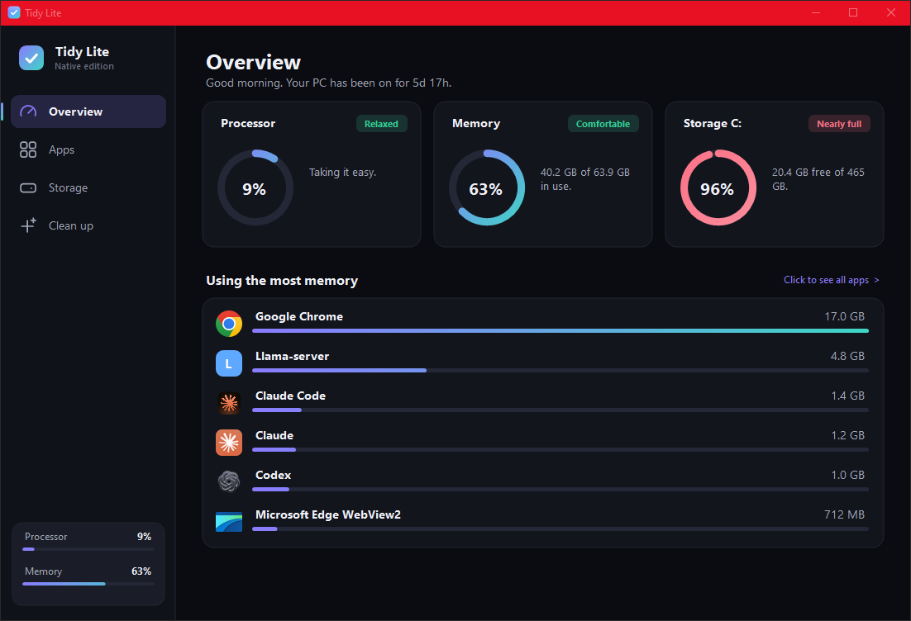
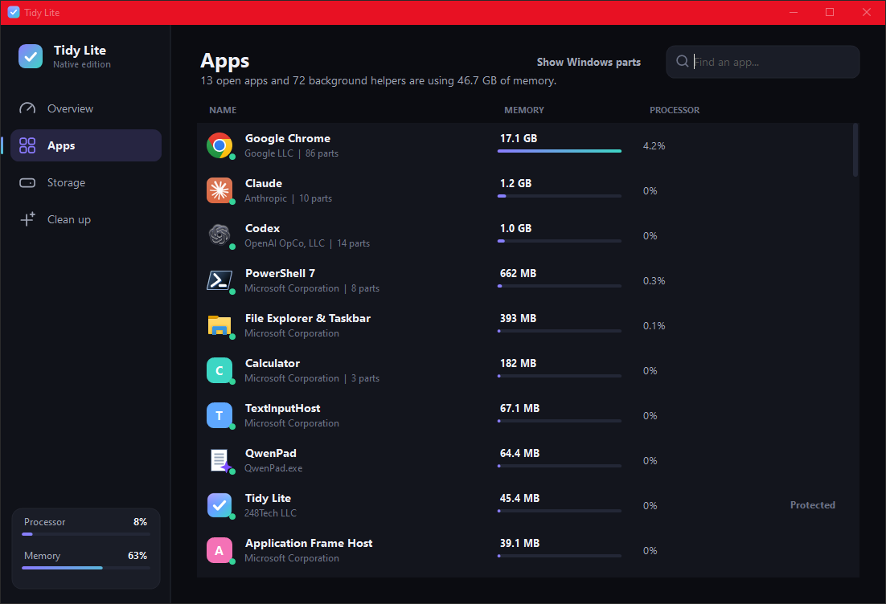
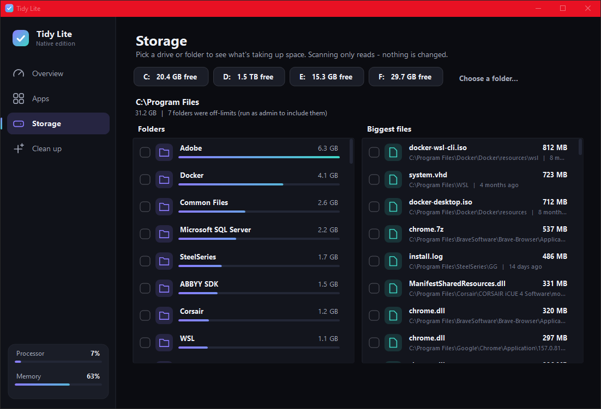
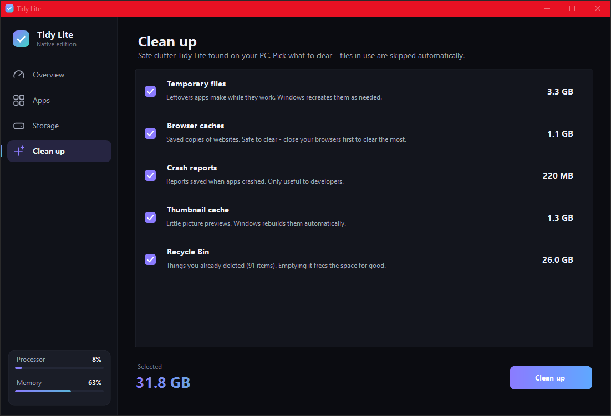

<div align="center">


# Tidy Lite

**The 111 KB Windows PC cleaner. A native app with no web engine, no runtime and no installer.**
See which apps use your memory, find the files filling your drive, and clean up safely. Built for old, slow or low-memory PCs.

No ads · No telemetry · No account · Open source

[-5fa8ff?style=for-the-badge&logo=windows&logoColor=white)](https://github.com/248Tech/Tidy-Lite/releases/latest/download/TidyLite.exe)
[](https://248tech.github.io/Tidy-Lite/)
[-8b7bff?style=for-the-badge)](https://github.com/248Tech/Tidy)

[](https://github.com/248Tech/Tidy-Lite/releases/latest)
[](https://github.com/248Tech/Tidy-Lite/releases)
[](https://github.com/248Tech/Tidy-Lite/actions/workflows/ci.yml)
[](LICENSE)
[](https://github.com/248Tech/Tidy-Lite/stargazers)


[**Download**](https://github.com/248Tech/Tidy-Lite/releases/latest) · [**Website**](https://248tech.github.io/Tidy-Lite/) · [Install guide](#install) · [Tidy (full)](https://github.com/248Tech/Tidy) · [Report a bug](https://github.com/248Tech/Tidy-Lite/issues)



</div>

## What is Tidy Lite?

**Keywords:** lightweight PC cleaner, tiny task manager alternative, disk space analyzer, free up disk space, what is using my RAM, end task, large file finder, temp file cleaner, portable, no installer, no telemetry, old PC, low RAM.

Tidy Lite is the native edition of [**Tidy**](https://github.com/248Tech/Tidy). It's the same friendly, plain-English idea, rebuilt as a plain Win32/WinForms app with nothing extra:

- **111 KB** download, compared with 13 MB for Tidy.
- **About 45 MB of memory** in total. There's no browser engine, no WebView and no Electron.
- **Nothing to install.** It uses the .NET Framework 4 that's already part of Windows 10 and 11.
- **Built with the C# compiler that ships with Windows**, so there are no NuGet packages and no third-party code.

## Features

| | |
|---|---|
| 📊 **Overview** | Processor, memory and system-drive gauges with plain-English moods ("Relaxed", "Getting full"), and the apps using the most memory. |
| 🧩 **Apps** | Processes grouped into apps with real icons, live memory and CPU, and a search box. **Close** politely or **Force quit**. Critical Windows processes are protected, and risky ones explain what will happen. |
| 💾 **Storage** | Scan any drive or folder, then click into folders sorted by size and browse a biggest-files list. Select items and **move them to the Recycle Bin, with Undo**. Hold Shift to delete forever. |
| ✨ **Clean up** | Temporary files, browser caches (Chrome, Edge, Brave, Vivaldi, Firefox), crash reports, the thumbnail cache, and the Recycle Bin, with sizes shown before you clean. |
| 🎨 **Native polish** | Custom-drawn dark or light UI that follows Windows, a dark title bar, crisp on high-DPI screens, and `Ctrl+1…4` page shortcuts. |

<table>
<tr>
<td></td>
<td></td>
</tr>
<tr>
<td colspan="2" align="center"></td>
</tr>
</table>

## Install

1. **Download** [`TidyLite.exe`](https://github.com/248Tech/Tidy-Lite/releases/latest/download/TidyLite.exe) (111 KB) from the [latest release](https://github.com/248Tech/Tidy-Lite/releases/latest), or the `.zip`.
2. **Put it anywhere**: your Desktop, a USB stick, or `C:\Users\<you>\AppData\Local\Programs\TidyLite\`.
3. **Double-click it.** If Windows SmartScreen says *"Windows protected your PC"*, click **More info → Run anyway**. The exe isn't code-signed yet.

**Optional: Start menu shortcut** (PowerShell, in the folder with `TidyLite.exe`):

```powershell
$s = (New-Object -ComObject WScript.Shell).CreateShortcut("$env:APPDATA\Microsoft\Windows\Start Menu\Programs\Tidy Lite.lnk")
$s.TargetPath = (Resolve-Path .\TidyLite.exe).Path; $s.Save()
```

**Verify the download:** `Get-FileHash .\TidyLite.exe` should match `SHA256SUMS.txt` on the release page.

**Requirements:** Windows 10 or 11, 64-bit. .NET Framework 4.x is built into both, so there's nothing else to install.

**Uninstall:** delete `TidyLite.exe`. It doesn't write settings, registry keys or log files.

**Command-line options:**

```
TidyLite.exe --page 2                 # open on Apps (1 Overview, 2 Apps, 3 Storage, 4 Clean up)
TidyLite.exe --scan "D:\Downloads"    # open Storage and scan that folder right away
```

## Tidy Lite vs Tidy

| | Tidy Lite | Tidy |
|---|---|---|
| Download | **111 KB** | 13 MB |
| Memory | **~45 MB total** | ~75 MB + WebView2 |
| Apps, Close / Force quit | ✅ | ✅ |
| Storage scan, Recycle Bin + Undo | ✅ lists | ✅ treemap |
| Clean up | ✅ | ✅ |
| Live graphs, command palette | — | ✅ |
| Remote access from your phone | — | ✅ |
| Web engine | **None** | WebView2 |

If you want the treemap, live graphs or phone access, get [**Tidy**](https://github.com/248Tech/Tidy).

## Safety & privacy

- **No network access at all.** Tidy Lite doesn't make network connections, collect telemetry or check for updates.
- **Recycle Bin first.** Deleted items can be restored with Undo. Items too big for the Recycle Bin are refused instead of being deleted forever without warning.
- **Protected:** System, csrss, lsass, winlogon, services and other critical processes can't be stopped. `C:\Windows`, `Program Files`, `ProgramData`, `Users`, your profile folder and `pagefile.sys` can't be deleted.

## Build from source

No SDK needed. Windows already includes the compiler.

```bat
git clone https://github.com/248Tech/Tidy-Lite
cd Tidy-Lite
build.cmd            :: → TidyLite.exe
```

`build.cmd` calls `%WINDIR%\Microsoft.NET\Framework64\v4.0.30319\csc.exe`. The source is C# 5, in four files:

```
src/Program.cs     entry point, DPI, command-line options
src/MainForm.cs    window, sidebar and the four pages
src/Controls.cs    theme, custom-drawn buttons, list and dialogs
src/Core.cs        metrics, process grouping, protections, scanner, Recycle Bin, cleaner
src/Native.cs      Win32 P/Invoke
```

## License

[MIT](LICENSE) © 2026 Joe Wayne / [248Tech LLC](https://248tech.github.io). Made by [248Tech](https://github.com/248Tech). See more projects at **[248tech.github.io](https://248tech.github.io)**.
